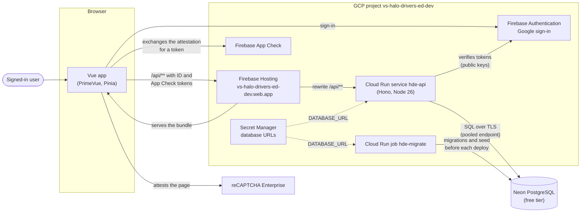
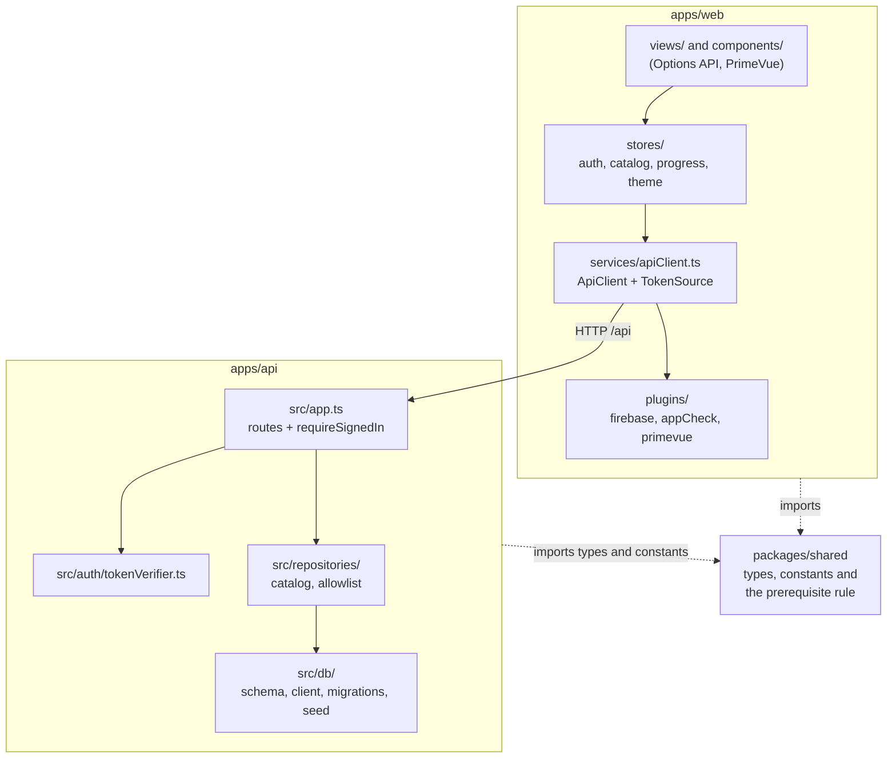
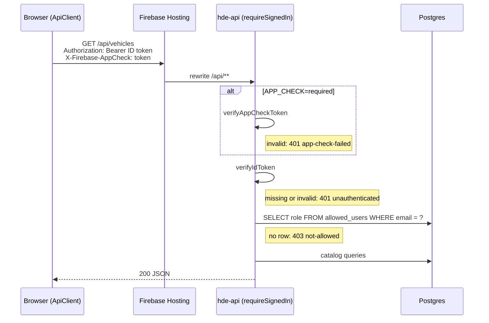
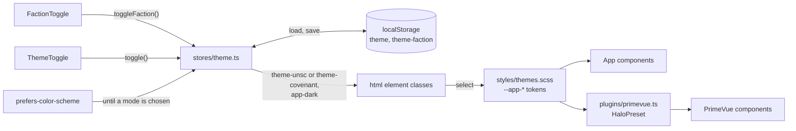
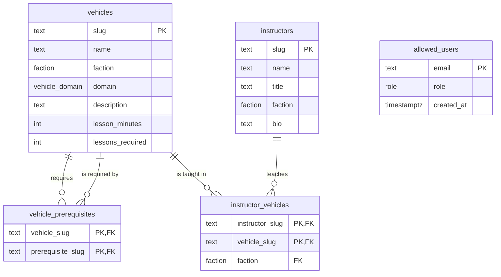
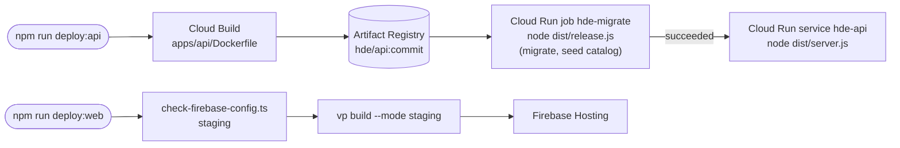

# Halo Drivers Ed Architecture

How the app is put together, and the main handoff document between sessions. Current status and what comes next are under [Project Status](#project-status).

## Documentation Map

| Document | Read it for |
| --- | --- |
| [README.md](README.md) | The introduction: what the app does and a quick start. |
| **ARCHITECTURE.md** (this file) | How the system is designed, with diagrams, and Project Status. |
| [docs/DEVELOPMENT.md](docs/DEVELOPMENT.md) | Machine setup, running locally, env files, commands, tests, CI, dependency decisions. |
| [docs/DEPLOYMENT.md](docs/DEPLOYMENT.md) | One-time GCP, Neon and Firebase setup, deploying, App Check, credential lockdown. |
| [docs/UI.md](docs/UI.md) | What each page does and how it looks. |

## System Overview

A Vue single-page app served by Firebase Hosting, with its own API on Cloud Run and a PostgreSQL database on Neon. The browser never talks to the database: every request goes through the API, which checks an App Check token, a Firebase ID token and the allowlist. Hosting forwards `/api/**` to the Cloud Run service, so the app and the API share one origin (no CORS).

The app is closed: only allowlisted accounts can sign in. Recruiters and hiring managers will get in through self-serve demo slots (see [Planned Design](#planned-design)).

### Tech Stack

- **Monorepo** with npm workspaces: `apps/web`, `apps/api`, `packages/shared`.
- **Web**: Vue 3 (Options API) + TypeScript, PrimeVue 4 (Aura, colored by the app's [theme tokens](#theming); components auto-imported), Pinia, Vue Router, SCSS with BEM class names, self-hosted fonts (Fontsource), Vite (through Vite+).
- **API**: Node 26 + TypeScript, Hono on `@hono/node-server`, Drizzle ORM and drizzle-kit migrations, `pg`, Firebase Admin SDK (token verification only). Run from source with Node's type stripping in development; bundled with esbuild for the container.
- **Shared**: the API's request and response types and constants, and the prerequisite rule (`@hde/shared`), imported as TypeScript source by both apps.
- **Data**: PostgreSQL 18; Neon in production, Docker Compose locally.
- **Tests**: Vitest (unit, and database tests against local Postgres), Playwright (E2E against the Auth emulator, a local API and the database).
- **Tooling**: Vite+ (`vite-plus`), which bundles Vite, Vitest, Oxlint and Oxfmt; configured in the root `vite.config.ts` and `apps/web/vite.config.ts`. ESLint runs only `eslint-plugin-vue`, on Vue components.

TypeScript is pinned to 6.x: TypeScript 7 (native compiler) does not expose the JS compiler API `vue-tsc` needs.

### Why These Choices

- **Neon instead of Cloud SQL.** Cloud SQL never scales to zero (about $10 a month idle). Neon's free tier (100 compute hours and 1 GB per project) suspends after 5 idle minutes, which suits a portfolio app; the first request after a pause takes about half a second longer. Moving to Cloud SQL later only changes the connection strings. Postgres cannot run on Cloud Run itself: its disk is not persistent.
- **One Cloud Run service, not a function per endpoint.** Bookings need transactions and a connection pool; a long-lived service with its own pool fits that better, and it still scales to zero.
- **Hosting rewrite instead of a separate API domain.** Same origin, so no CORS, and one domain for the API key and reCAPTCHA restrictions. The service allows unauthenticated invocation because Hosting calls it without IAM credentials; the API's own checks protect it.
- **Postgres constraints over application checks.** Rules that must never break live in the database: an instructor can only teach their own faction's vehicles (composite foreign keys), and bookings will use an exclusion constraint against double-booking.

## Application Layers

The API's routes depend on interfaces (`TokenVerifier`, `CatalogRepository`, `AllowlistRepository`), and `src/server.ts` wires in the Firebase and Postgres implementations. The unit tests pass fakes instead, so they need neither Firebase nor a database.

## Request Authorization

Every route under `/api` except `/api/health` goes through `requireSignedIn` in `apps/api/src/app.ts`. The web app's `ApiClient` attaches both tokens to each request.

`APP_CHECK=off` exists only for the emulators. `loadConfig` refuses to start on Cloud Run (`K_SERVICE` set) with App Check off or with `FIREBASE_AUTH_EMULATOR_HOST` set, since either would let anyone in.

On the web side, `stores/auth.ts` calls `GET /api/me` after each Google sign-in. A `not-allowed` answer signs the account out with a message on the login page; other failures keep it signed in so a retry can succeed. The popup and the auth listener share one check.

## Theming

A theme is a faction plus a color mode. `stores/theme.ts` sets classes on `<html>`, which select the tokens in `styles/themes.scss`. PrimeVue's preset only refers to those tokens, so switching needs no new preset.

## Data Model

- `faction` is an enum (`unsc`, `covenant`). `instructor_vehicles.faction` is part of both foreign keys, to `instructors(slug, faction)` and `vehicles(slug, faction)`, so a mismatch is rejected by Postgres.
- `allowed_users.email` is stored lowercase (a check constraint enforces it). `role` has only `admin` for now.
- The catalog (vehicles, instructors, who teaches what) is seed data in `apps/api/src/db/catalogData.ts`, loaded by `npm run db:seed`. Instructors are seeded characters, not accounts.
- Schema changes: edit `apps/api/src/db/schema.ts`, run `npm run db:generate`, and commit the new file in `apps/api/drizzle/`.

## Deployment

One image holds both entry points. Migrations and the catalog seed run as their own job, with an owner database role, before the service rolls out; the service uses a role that can only read and write rows. Details and the one-time setup are in [docs/DEPLOYMENT.md](docs/DEPLOYMENT.md).

## Planned Design

Agreed, not built yet. Build these on their own branches.

### Admin Access and "View As"

The owner's account (role `admin`) sees everything in the backend: all bookings, all students and every instructor's schedule. An admin can also **view as** one instructor, which scopes the pages to what that instructor would see, or switch back to viewing everything. Since instructors are seeded characters rather than accounts, "view as" is a filter the API applies for admins, not an impersonated sign-in:

- Admin-only endpoints accept an optional instructor (e.g. `?instructor=master-chief`); without it they return everything. The API ignores or rejects the parameter for other roles.
- The web app keeps the chosen instructor in a Pinia store, shows it in the header with a way to clear it, and passes it on every request.

### Bookings

- `availability`: each instructor's weekly windows, seeded.
- `bookings`: student, instructor, vehicle, and a `tstzrange` for the lesson. Exclusion constraints (`btree_gist`) make overlapping bookings for the same instructor, or the same vehicle, impossible. The lesson length comes from the vehicle.
- Prerequisites: a booking for a vehicle requires its prerequisite courses to be complete (`lessons_required` lessons done). The API enforces this with `missingPrerequisites` from `@hde/shared`, which the web app already uses for its locks, and serves the student's completed courses to `stores/progress.ts`.

### Demo Slots for Recruiters

Self-serve, no code to request:

- "Try the demo" on the login page signs the visitor in anonymously with Firebase (App Check still applies).
- `POST /api/demo-sessions` claims one of N rows in a `demo_slots` table with `SELECT ... FOR UPDATE SKIP LOCKED`, taking a free or expired slot. The row count is the cap; no race can exceed it.
- Reusing an expired slot deletes its old guest's data in the same transaction: guest records reference the slot session with `ON DELETE CASCADE`.
- Guests get a `guest` role: the seeded catalog, only their own bookings, and a booking cap. When every slot is taken, the page says when the next one frees up.
- Lazy reclamation means no scheduled job is needed at first.

## Diagram Index

Every diagram in this file, and what it depends on. A change to these sources updates the matching diagram in the same pull request.

| Diagram | Section | Update it when these change |
| --- | --- | --- |
| System context | [System Overview](#system-overview) | GCP or Firebase services, Neon, `firebase.json` rewrites, `apps/web/src/plugins/firebase.ts` |
| Application layers | [Application Layers](#application-layers) | Folders under `apps/*/src`, `packages/shared`, `apps/api/src/server.ts` |
| Request authorization | [Request Authorization](#request-authorization) | `apps/api/src/app.ts`, `apps/api/src/config.ts`, `apps/web/src/services/apiClient.ts`, `apps/web/src/stores/auth.ts` |
| Theming | [Theming](#theming) | `apps/web/src/stores/theme.ts`, `apps/web/src/utils/themePreference.ts`, `apps/web/src/styles/themes.scss`, `apps/web/src/plugins/primevue.ts`, `FactionToggle.vue`, `ThemeToggle.vue` |
| Tables | [Data Model](#data-model) | `apps/api/src/db/schema.ts`, `apps/api/drizzle/` |
| Deploy pipeline | [Deployment](#deployment) | `scripts/deploy-api.ts`, `apps/api/Dockerfile`, `apps/api/cloudbuild.yaml`, `firebase.json` |

## Project Status

### Done

- Monorepo scaffold: web (Vue 3 Options API, PrimeVue 4, Pinia, Router), API (Hono, Drizzle), shared types; Vite+ (Vite, Vitest, Oxlint, Oxfmt), ESLint for Vue components, Playwright, CI.
- Google sign-in with the allowlist held by the API (`GET /api/me`), and a route guard.
- API with App Check and ID token checks, JSON errors, and a config that refuses unsafe settings on Cloud Run.
- Postgres schema and first migration: vehicles, prerequisites, instructors, who teaches what, allowlist. Seeded catalog of 10 vehicles and 6 instructors.
- Courses page: vehicles on a route map of their prerequisites, and instructors, by faction.
- Locks on courses whose prerequisites are not complete, and a book button in the vehicle details (a placeholder until bookings). Completed courses (`stores/progress.ts`) are always empty for now, so only the Mongoose and Ghost are open.
- UNSC and Covenant themes, each light and dark, with placeholder artwork.
- Local development with Docker Postgres and the Auth emulator; unit, database and E2E tests.
- API image, Cloud Build config and deploy script (migrate job, then service).
- Deployed on 2026-11-19 to `vs-halo-drivers-ed-dev`: the `hde-api` Cloud Run service, the `hde-migrate` job (tables and catalog seed in Neon) and the site at https://vs-halo-drivers-ed-dev.web.app, with the owner's account allowlisted. The whole [one-time setup](docs/DEPLOYMENT.md#one-time-setup) is done.
- App Check: reCAPTCHA Enterprise registered for the web app, enforced for Authentication and required by the API; a debug token for `npm run dev:staging`, which proxies `/api` to the deployed API.
- Credentials locked down: the Firebase web API key allows only the hosted domains and `localhost:5173`, and only the Identity Toolkit, Token Service and App Check APIs; each service account has only its listed roles.

### Next: Decisions (need the owner)

1. PrimeVue 5 (see [Dependency Decisions](docs/DEVELOPMENT.md#dependency-decisions)).
2. The repository's visibility (private for now).

### Next: Features

1. Bookings: availability, the booking flow, double-booking constraints, prerequisite checks.
2. Admin "View As" an instructor, or everything.
3. Demo slots for recruiters.
4. Final artwork: the vehicle and instructor drawings are temporary placeholders that do not closely resemble their Halo 3 designs. Options considered: the owner's own screenshots (under Microsoft's Game Content Usage Rules, with their notice), generated images, or commissioned art. See [Artwork](docs/UI.md#artwork).
