# Halo Drivers Ed Architecture

How the app is put together, and where it stands. Current status and what comes next are under [Project Status](#project-status).

## Documentation Map

| Document | Read it for |
| --- | --- |
| [README.md](README.md) | The introduction: what the app does and a quick start. |
| **ARCHITECTURE.md** (this file) | How the system is designed, with diagrams, and Project Status. |
| [docs/DEVELOPMENT.md](docs/DEVELOPMENT.md) | Machine setup, running locally, env files, commands, tests, CI, dependency decisions. |
| [docs/DEPLOYMENT.md](docs/DEPLOYMENT.md) | One-time GCP, Neon and Firebase setup, deploying, App Check, credential lockdown. |
| [docs/UI.md](docs/UI.md) | What each page does and how it looks. |

## System Overview

A Vue single-page app served by Firebase Hosting, with its own API on Cloud Run and a PostgreSQL database on Neon. The browser never talks to the database: every request goes through the API, which checks an App Check token, a Firebase ID token and the allowlist, and limits each account's requests. Hosting forwards `/api/**` to the Cloud Run service, so the app and the API share one origin (no CORS).

The app is closed: only allowlisted accounts can sign in. Recruiters and hiring managers get in through self-serve [demo](#demo) slots.

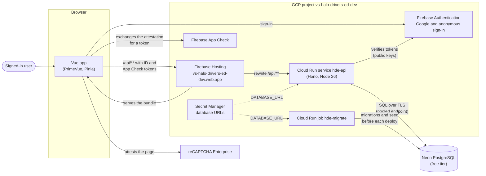

### Tech Stack

- **Monorepo** with npm workspaces: `apps/web`, `apps/api`, `packages/shared`.
- **Web**: Vue 3 (Options API) + TypeScript, PrimeVue 4 (Aura, colored by the app's [theme tokens](#theming); components auto-imported), Pinia, Vue Router, SCSS with BEM class names, self-hosted fonts (Fontsource), Vite (through Vite+).
- **API**: Node 26 + TypeScript, Hono on `@hono/node-server`, Drizzle ORM and drizzle-kit migrations, `pg`, Firebase Admin SDK (token verification only). Run from source with Node's type stripping in development; bundled with esbuild for the container.
- **Shared**: the API's request and response types and constants, and the booking rules both apps apply (`@hde/shared`), imported as TypeScript source by both apps.
- **Data**: PostgreSQL 18; Neon when deployed, Docker Compose locally.
- **Tests**: Vitest (unit, and database tests against local Postgres), Playwright (E2E against the Auth emulator, a local API and the database).
- **Tooling**: Vite+ (`vite-plus`), which bundles Vite, Vitest, Oxlint and Oxfmt; configured in the root `vite.config.ts` and `apps/web/vite.config.ts`. ESLint runs only `eslint-plugin-vue`, on Vue components.

Versions held back, and why, are under [Dependency Decisions](docs/DEVELOPMENT.md#dependency-decisions).

### Why These Choices

- **Neon instead of Cloud SQL.** Cloud SQL never scales to zero (about $10 a month idle). Neon's free tier (100 compute hours and 1 GB per project) suspends after 5 idle minutes, which suits a portfolio app; the first request after a pause takes about half a second longer. Moving to Cloud SQL later only changes the connection strings. Postgres cannot run on Cloud Run itself: its disk is not persistent.
- **One Cloud Run service, not a function per endpoint.** Bookings need transactions and a connection pool; a long-lived service with its own pool fits that better, and it still scales to zero.
- **Hosting rewrite instead of a separate API domain.** Same origin, so no CORS, and one domain for the API key and reCAPTCHA restrictions. The service allows unauthenticated invocation because Hosting calls it without IAM credentials; the API's own checks protect it.
- **Postgres constraints over application checks.** Rules that must never break live in the database: an instructor can only teach their own faction's vehicles (composite foreign keys), and exclusion constraints prevent double-booking.

## Application Layers

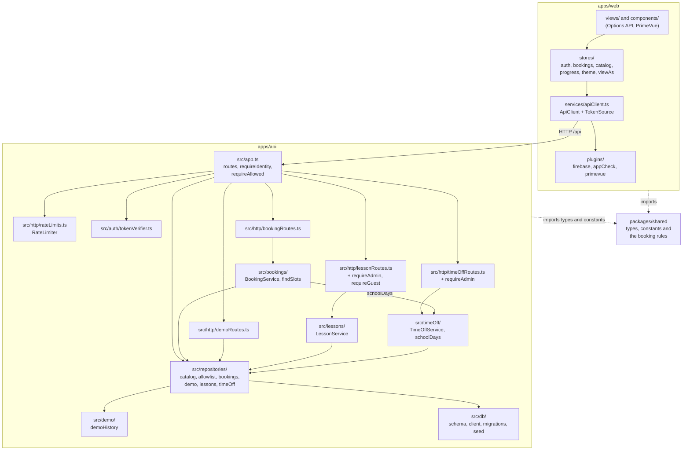

The API's routes depend on interfaces (`TokenVerifier`, `CatalogRepository`, `AllowlistRepository`, `BookingRepository`, `DemoRepository`, `LessonRepository`, `TimeOffRepository`), and `src/server.ts` wires in the Firebase and Postgres implementations. The unit tests pass fakes instead, so they need neither Firebase nor a database.

## Request Authorization

Every route under `/api` except `/api/health` goes through `requireIdentity`, `rateLimit` and `requireAllowed`, set up in `apps/api/src/app.ts`. The web app's `ApiClient` attaches both tokens to each request.

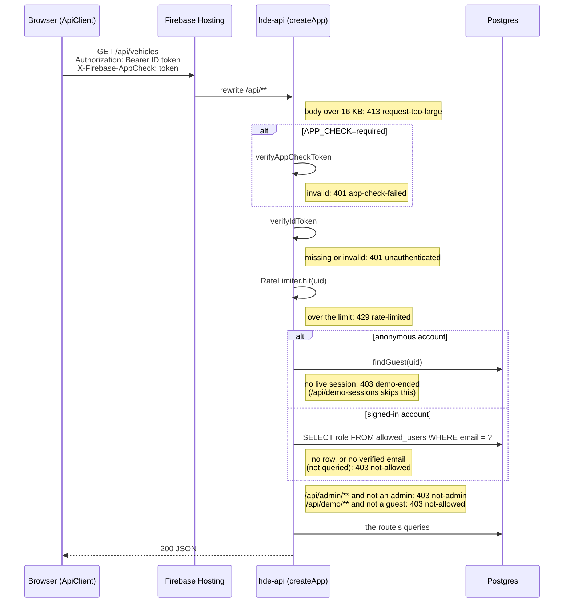

- An email counts only if the token says it is verified (`toVerifiedUser`). Otherwise, if email/password sign-in were ever enabled, someone could register an allowlisted address.
- Each account may make 240 requests a minute, 60 of them writes (`DEFAULT_RATE_LIMITS`). The counts are in memory, so with up to 2 Cloud Run instances an account could get twice that. They come before the allowlist query, so a stranger's account cannot load the database either.
- Responses are sent with `Cache-Control: private, no-store`, since they hold personal data.
- An ID token stays valid for up to an hour after sign-out, accepted because removing an account from the allowlist takes effect at once.

`APP_CHECK=off` exists only for the emulators. `loadConfig` refuses to start on Cloud Run (`K_SERVICE` set) with App Check off or with `FIREBASE_AUTH_EMULATOR_HOST` set, since either would let anyone in.

On the web side, `stores/auth.ts` calls `GET /api/me` after each sign-in, and first claims a [demo](#demo) slot when one was asked for. A `not-allowed` answer signs the account out with a message on the login page; other failures keep it signed in so a retry can succeed. The popup and the auth listener share one check.

### Known Limits

The design does not rely on the code being private. What an attacker who has read it can still do:

- **Use up the demo.** App Check raises the cost but does not stop a real browser from signing in anonymously again and again, which can take all the slots or, briefly, instructors' free times. Guests never see or change anyone else's data, and theirs is deleted.
- **Slow the API down.** Rate limits are per account, so requests without a valid token are refused before any query but still use CPU. Two instances at most caps the cost, not the disruption.
- **Replay an App Check token** outside a browser until it expires, as with any such token. The ID token, the allowlist and the rate limits still apply.

## Security Headers

`firebase.json` sends a Content Security Policy, `X-Content-Type-Options` and `Referrer-Policy` with the site's own files. What the policy allows, and why:

| Directive | Allows | For |
| --- | --- | --- |
| `script-src`, `frame-src`, `connect-src` | `www.google.com/recaptcha/`, `www.gstatic.com/recaptcha/` (scripts) | App Check's reCAPTCHA |
| `script-src` | `apis.google.com` | The sign-in frame's loader |
| `frame-src` | `vs-halo-drivers-ed-dev.firebaseapp.com` | The sign-in frame |
| `connect-src` | `identitytoolkit`, `securetoken` and `content-firebaseappcheck` on `googleapis.com` | Firebase Auth and App Check |
| `style-src` | `'unsafe-inline'` | PrimeVue adds its styles to the page at runtime, and static hosting cannot give them nonces |
| `img-src` | `data:` | Small drawings, inlined by Vite |

- The rule's `regex` leaves out `/__/**`, Firebase's own pages: the app frames the sign-in one from another domain, which `frame-ancestors 'none'` would block.
- `Referrer-Policy` must keep sending the origin, since the API key and reCAPTCHA key check it.
- There is no `Cross-Origin-Opener-Policy`, which could cut off the sign-in popup.
- The emulators and the dev server do not send these headers, so changes to them need testing on the deployed site. A production project needs its own `firebaseapp.com` domain in `frame-src`.

## Booking

`GET /api/slots` offers times from the instructor's hours, half an hour apart, for the next 14 days, leaving out [time off](#time-off) and any that clash with a lesson of the student, instructor or vehicle. `POST /api/bookings` checks the time is still offered, then books it in a transaction. The student's `allowed_users` row is locked for the prerequisite and lesson-count checks, so two requests cannot both pass them; the exclusion constraints settle races between students.

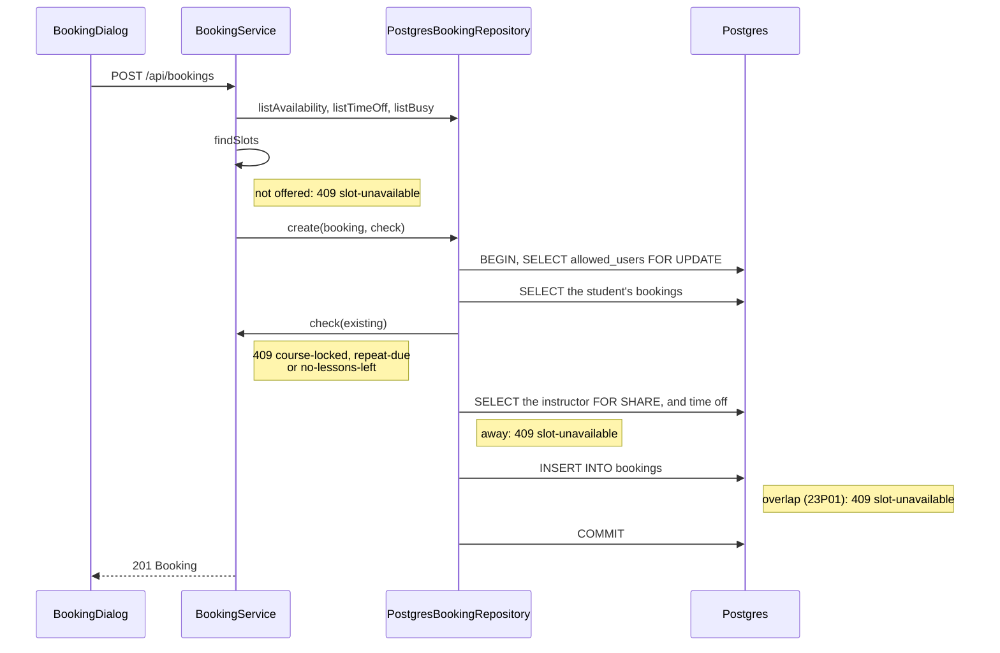

**Rescheduling** moves a lesson to another time, instructor or both, in one transaction, so a student never gives up the old time without getting the new one. It is the same booking, so it keeps any marks and notes, and does not count again toward a course's lessons or a guest's limit. The new time can overlap the old one.

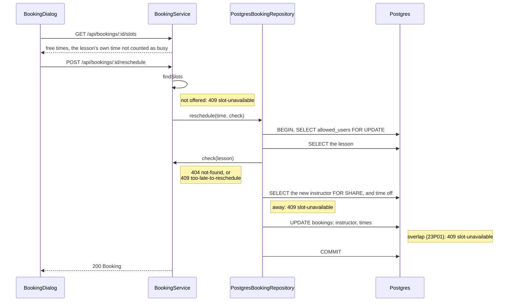

A lesson can be cancelled or rescheduled until 24 hours before it starts. It counts toward its course when completed, and a missed or cancelled lesson can be booked again. While a lesson has to be repeated, only its repeat can be booked: one lesson at a time in that course (`repeatDue`), until it is completed. Lessons already booked when it was marked stay booked, and the soonest becomes the repeat. Completed courses are worked out from the bookings (`completedCourses` in `@hde/shared`), by the API to enforce locks and by `stores/progress.ts` to show them.

## Demo

"Try the demo" on the login page signs the visitor in anonymously with Firebase, then claims one of the rows in `demo_slots` (`DEMO_SLOTS`). The row count is the cap, and `FOR UPDATE SKIP LOCKED` gives visitors who arrive together different rows. A row whose session expired is free to reuse, and requests clear expired guests, so no scheduled job is needed.

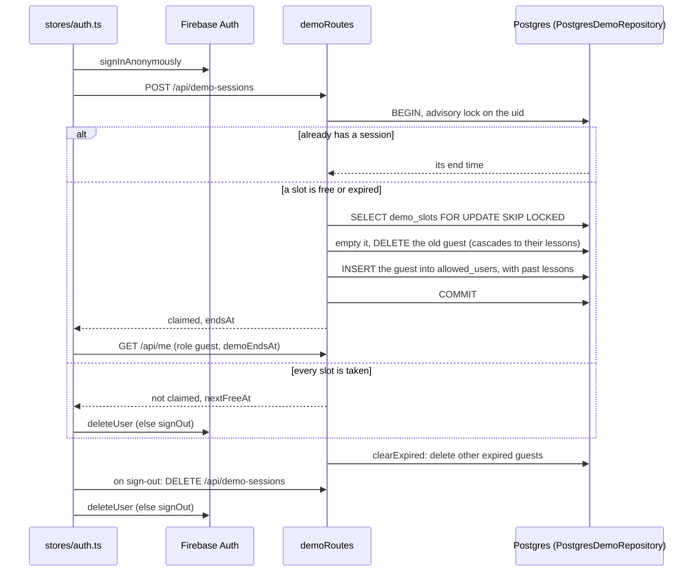

- **Identity.** A guest is an `allowed_users` row with the role `guest` and a made-up `@demo.invalid` address, so bookings, locks and cascades work as for anyone else. A check constraint ties the role to that domain, where no real address can exist, and the allowlist lookup never returns guests. They are found by the anonymous `uid` in their slot, only until it expires (`demo-ended` after that).
- **Limits.** Guests are students, and can book `DEMO_BOOKING_LIMIT` lessons, counting cancelled and signed-off ones. The check runs under the same lock as the other booking rules.
- **Past lessons.** Guests start with the Mongoose course and three of the Warthog's four lessons completed, and the fourth, their latest, to repeat (`demoHistory.ts`). Completing it unlocks the Scorpion and the Hornet. They also have one of the Ghost's two lessons completed; the other unlocks the Banshee and the Wraith. Each slot's are in a week of its own, in free times, so guests never clash.
- **Expired guests** lose access at once. Their data is deleted by the next claim, or the next request their lessons could affect: `GET /api/slots`, `POST /api/bookings`, rescheduling, `GET /api/admin/lessons` and adding time off (`clearExpiredDemos`). Signing out deletes it immediately.
- **Anonymous accounts** are deleted by the browser on sign-out, or when the demo is full or over, unless Firebase refuses. A visitor who closes the tab leaves theirs in Firebase; deleting those would need Identity Platform or an API that may delete Firebase users.
- **In the schedule**, guests' lessons are hidden unless an admin checks "Show demo guests".
- **A visitor could take every slot** by signing in anonymously repeatedly. App Check makes that harder, and slots free up when they expire.

## Time Off

Admins add whole days an instructor is away, in the school's time zone, from the Schedule. Those days are left out of `GET /api/slots`, and booking refuses them. Demo guests cannot add any, since instructors are shared.

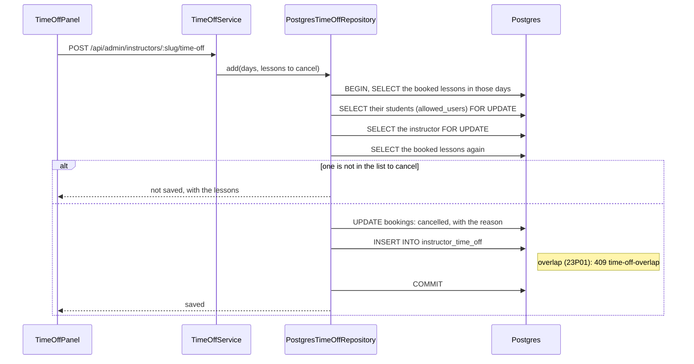

- **Booking waits for time off, and time off for booking.** Booking (and rescheduling) locks the instructor `FOR SHARE` and then checks for time off. Both lock students before the instructor, so they cannot deadlock.
- **Lessons that are over** but not signed off do not get in the way.

## Lesson Sign-Off

Each booked lesson has a form: the skills of the first lesson in its course the student has not completed. From when the lesson starts, each mark is saved on its own (`PUT /api/:scope/lessons/:id/results/:skillId`), so marks made together do not overwrite each other; `MarkSaver` in the web app sends one skill's marks in order. The lesson is signed off once it ends (`PUT .../sign-off`). Both refuse to be early unless the request says `early: true`, an override only the accounts that sign lessons off have. The instructors are seeded characters, so others do this, optionally viewing as one (`?instructor=` on `GET /api/:scope/lessons`, a filter rather than another sign-in).

The scope is `admin` for admins (`requireAdmin`), who sign off everyone's lessons, or `demo` for [demo](#demo) guests (`requireGuest`), who sign off only their own. Both use `signOffRoutes`. For guests, `LessonService` takes their address as `student` and answers any other lesson as if it did not exist, checking changes inside the transaction that makes them.

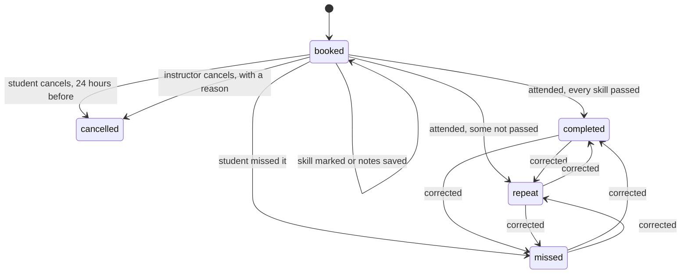

- Only `completed` counts toward the course. After `repeat`, the next lesson has the same form, with the skills already passed kept.
- **Cancelling.** `PUT .../cancel` cancels a lesson on the instructor's behalf, any time until it is signed off, with a reason the student sees (`cancelReason`). It discards the marks. Guests' limit still counts it.
- **Notes.** A lesson has a note for the student and a private one, saved together (`PUT .../notes`) from when the lesson starts, apart from the marks, and corrected by signing off again. Students get only their own note, in `LessonForm`, once the lesson is signed off as attended. `InstructorForm` adds the private one and the history.
- **History.** An instructor's form has the student's earlier signed-off lessons in the course, with results and notes. The student's own results (`GET /api/results`) are shown in the courses page's lesson plan.
- Lessons in a course are signed off in order, and one can be corrected until a later one is signed off.
- A correction is refused if it would lock a course the student has lessons in, or leave them with more lessons than the course has.
- `PostgresLessonRepository.update` takes the same lock on the student's `allowed_users` row as booking, rescheduling and cancelling do, so none can change what another decided on.

## Certificates

Each completed course has a certificate, at `/certificates/:vehicleSlug`. Nothing is stored: it is worked out from the student's own bookings, as course locks are, so it goes away if a correction means the course is no longer complete. Only the student can see theirs.

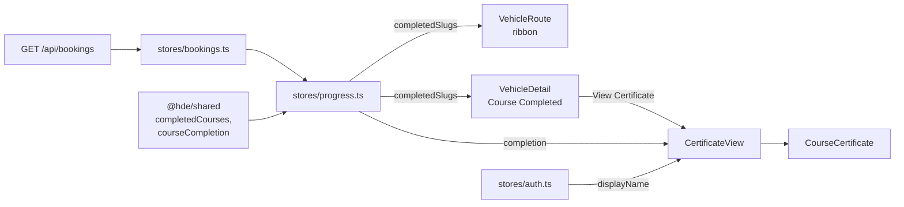

The final lesson gives the instructor and the date, which is when it ended, or was signed off if that was earlier, as demo guests can do. Printing uses the browser's own dialog, which can save a PDF; a named `@page` makes it landscape.

## Theming

A theme is a faction plus a color mode. `stores/theme.ts` sets classes on `<html>`, which select the tokens in `styles/themes.scss`. PrimeVue's preset only refers to those tokens, so switching needs no new preset.

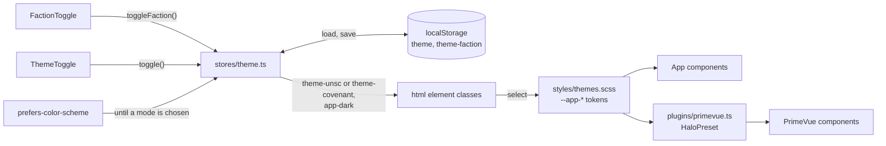

## Data Model

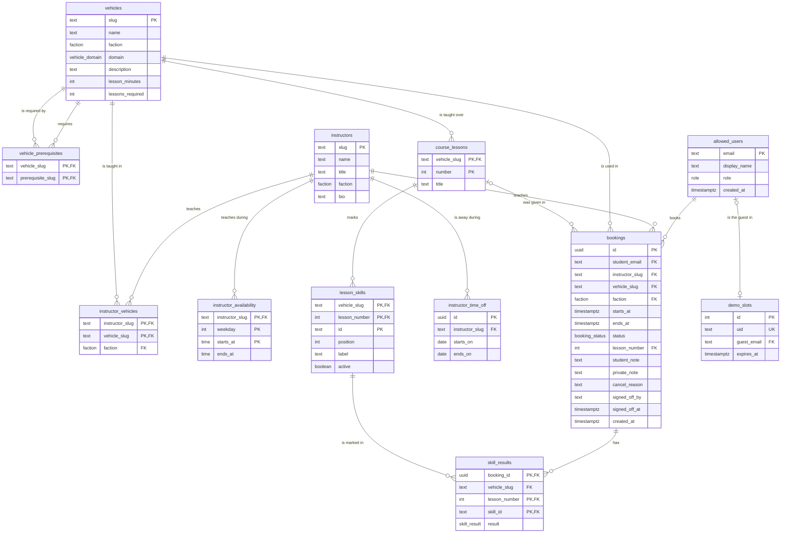

- `faction` is an enum (`unsc`, `covenant`). `instructor_vehicles.faction` is part of both foreign keys, to `instructors(slug, faction)` and `vehicles(slug, faction)`, so a mismatch is rejected by Postgres.
- `allowed_users.email` is stored lowercase (a check constraint enforces it). `role` is `admin`, `student` or `guest`: all can book, and only admins reach `/api/admin`. Guests come and go with their [demo](#demo) session.
- `bookings` has three exclusion constraints (migration `0002_booking_exclusions`, using `btree_gist`): a student, an instructor and a vehicle each have one lesson at a time. Cancelled lessons do not count. It references vehicles and instructors with their faction, but not `instructor_vehicles`, which each seed replaces.
- `instructor_availability` holds wall-clock times in `America/New_York`, seeded from `apps/api/src/db/availabilityData.ts`.
- `allowed_users.display_name` is the Google account's name, stored by `GET /api/me` at sign-in, so instructors can see who a student is.
- `course_lessons` and `lesson_skills` are seeded from `apps/api/src/db/curriculumData.ts`. A skill dropped from the data becomes inactive rather than deleted, since results refer to it, so skill ids must not be reused.
- Checks on `bookings` require a signature on signed-off lessons, and a lesson number on attended ones, and limit the notes to 1,000 characters each. Only a cancelled lesson can have a `cancel_reason`.
- `instructor_time_off` has an exclusion constraint (migration `0008_time_off_exclusion`): an instructor's time off cannot overlap.
- The catalog (vehicles, instructors, who teaches what) is seed data in `apps/api/src/db/catalogData.ts`, loaded by `npm run db:seed`. Instructors are seeded characters, not accounts.
- `npm run db:clear` deletes bookings and what hangs off them (`apps/api/src/db/clearData.ts`), under the locks the API takes. It is a command rather than an admin feature so that erasing data needs the database's credentials. See [Clearing Data](docs/DEVELOPMENT.md#clearing-data).
- Schema changes: edit `apps/api/src/db/schema.ts`, run `npm run db:generate`, and commit the new file in `apps/api/drizzle/`.

## Deployment

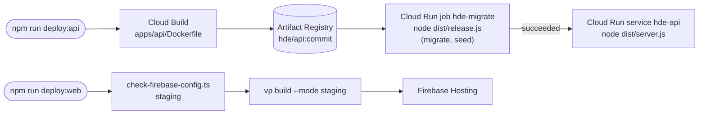

One image holds both entry points. Migrations and the seed of the catalog and demo slots run as their own job, with an owner database role, before the service rolls out; the service uses a role that can only read and write rows. Details and the one-time setup are in [docs/DEPLOYMENT.md](docs/DEPLOYMENT.md).

## Planned Design

Nothing is agreed and waiting to be built, apart from [final artwork](#next-features).

### Ideas, Not Planned

Ending a demo after 30 idle minutes, if visitors take up places. Calendar (`.ics`) downloads, email reminders (need a mail provider), and an `instructor` role limited to its own lessons (View As covers it for now). Messaging, payments and ratings are left out.

## Diagram Index

Every diagram in this file, and what it depends on. A change to these sources updates the matching diagram in the same pull request.

| Diagram | Section | Update it when these change |
| --- | --- | --- |
| System context | [System Overview](#system-overview) | GCP or Firebase services, Neon, `firebase.json` rewrites, `apps/web/src/plugins/firebase.ts` |
| Application layers | [Application Layers](#application-layers) | Folders under `apps/*/src`, `packages/shared`, `apps/api/src/server.ts` |
| Request authorization | [Request Authorization](#request-authorization) | `apps/api/src/app.ts`, `apps/api/src/http/rateLimits.ts`, `apps/api/src/auth/tokenVerifier.ts`, `apps/api/src/config.ts`, `apps/web/src/services/apiClient.ts`, `apps/web/src/stores/auth.ts` |
| Booking, rescheduling | [Booking](#booking) | `apps/api/src/bookings/`, `apps/api/src/http/bookingRoutes.ts`, `apps/api/src/repositories/bookingRepository.ts`, `packages/shared/src/bookings.ts` |
| Demo | [Demo](#demo) | `apps/api/src/http/demoRoutes.ts`, `apps/api/src/repositories/demoRepository.ts`, `apps/api/src/demo/`, `packages/shared/src/demo.ts`, `apps/web/src/stores/auth.ts` |
| Time off | [Time Off](#time-off) | `apps/api/src/timeOff/`, `apps/api/src/http/timeOffRoutes.ts`, `apps/api/src/repositories/timeOffRepository.ts`, `apps/web/src/components/TimeOffPanel.vue` |
| Lesson sign-off | [Lesson Sign-Off](#lesson-sign-off) | `apps/api/src/lessons/`, `apps/api/src/http/lessonRoutes.ts`, `apps/api/src/repositories/lessonRepository.ts`, `packages/shared/src/curriculum.ts` |
| Certificates | [Certificates](#certificates) | `packages/shared/src/bookings.ts`, `apps/web/src/stores/progress.ts`, `apps/web/src/views/CertificateView.vue`, `VehicleRoute.vue`, `VehicleDetail.vue` |
| Theming | [Theming](#theming) | `apps/web/src/stores/theme.ts`, `apps/web/src/utils/themePreference.ts`, `apps/web/src/styles/themes.scss`, `apps/web/src/plugins/primevue.ts`, `FactionToggle.vue`, `ThemeToggle.vue` |
| Tables | [Data Model](#data-model) | `apps/api/src/db/schema.ts`, `apps/api/drizzle/` |
| Deploy pipeline | [Deployment](#deployment) | `scripts/deploy-api.ts`, `apps/api/Dockerfile`, `apps/api/cloudbuild.yaml`, `firebase.json` |

## Project Status

### Done

- Monorepo scaffold: web (Vue 3 Options API, PrimeVue 4, Pinia, Router), API (Hono, Drizzle), shared types; Vite+ (Vite, Vitest, Oxlint, Oxfmt), ESLint for Vue components, Playwright, CI.
- Google sign-in with the allowlist held by the API (`GET /api/me`), and a route guard.
- API with App Check and ID token checks, JSON errors, and a config that refuses unsafe settings on Cloud Run.
- Security hardening: verified emails only, request size and per-account rate limits, and [security headers](#security-headers). Deployed on 2026-11-24 and checked on the site: no policy violations in the console, and no policy on `/__/auth/`.
- Postgres schema and first migration: vehicles, prerequisites, instructors, who teaches what, allowlist. Seeded catalog of 10 vehicles and 6 instructors.
- Courses page: vehicles on a route map of their prerequisites, and instructors, by faction.
- Locks on courses whose prerequisites are not complete, enforced by the API.
- Course progress on the route map and in the vehicle's panel, and repeats before the next lesson.
- Booking: instructor hours, lesson times, booking and cancelling, My lessons, and exclusion constraints against double-booking.
- Lesson plans (53 lessons), instructors' lesson forms, sign-off that unlocks courses, notes and student history, and admins' schedule with View As. Demo guests have the same for their own lessons. Deployed and tried on the site on 2026-11-24.
- Instructors' [time off](#time-off), and cancelling lessons on their behalf. Deployed and tried on the site on 2026-11-24.
- `npm run db:clear`, to delete everyone's, a student's or an instructor's data.
- [Rescheduling](#booking) a lesson. Deployed and tried on the site on 2026-11-24.
- [Certificates](#certificates) for completed courses, and a Ghost lesson in guests' history. Deployed on 2026-11-24.
- A lesson can no longer be cancelled and signed off at the same time, and API responses are not cached. Deployed on 2026-11-24.
- A menu for the app bar on narrow screens, and a footer notice. Deployed on 2026-11-24.
- Public since 2026-11-24, under the MIT License. Before that, the history, pull requests and files were searched for secrets, and the backend and its GCP settings reviewed for an attacker who has the code ([Known Limits](#known-limits)). On GitHub: a ruleset on `main` (pull requests and both CI jobs required, no bypass), secret scanning with push protection, Dependabot alerts and security updates, CodeQL, approval for outside contributors' CI runs, and private vulnerability reporting. Secret scanning reports the Firebase web API key, which is public by design and restricted.
- A `student` role, which can book but not sign off.
- [Demo](#demo) slots for recruiters: 10 at once, 2 hours each. Deployed and tried on the site on 2026-11-24, including that signing out removes the anonymous account.
- UNSC and Covenant themes, each light and dark, with placeholder artwork.
- Local development with Docker Postgres and the Auth emulator; unit, database and E2E tests.
- API image, Cloud Build config and deploy script (migrate job, then service).
- `npm run deploy:web` works on Windows: its hosting build hook no longer names a workspace. Deployed from Windows on 2026-11-25.
- Deployed on 2026-11-19 to `vs-halo-drivers-ed-dev`: the `hde-api` Cloud Run service, the `hde-migrate` job (tables and catalog seed in Neon) and the site at https://vs-halo-drivers-ed-dev.web.app, with the owner's account allowlisted. The whole [one-time setup](docs/DEPLOYMENT.md#one-time-setup) is done.
- App Check: reCAPTCHA Enterprise registered for the web app, enforced for Authentication and required by the API; a debug token for `npm run dev:staging`, which proxies `/api` to the deployed API.
- Credentials locked down: the Firebase web API key allows only the hosted domains and `localhost:5173`, and only the Identity Toolkit, Token Service and App Check APIs; each service account has only its listed roles.

### To Check

- Accounts allowlisted before the `student` role existed are admins, who can sign off everyone's lessons. Change others with `npm run db:allow -- <email> student`.

### Next: Decisions (need the owner)

- PrimeVue 5 (see [Dependency Decisions](docs/DEVELOPMENT.md#dependency-decisions)).

### Next: Features

1. Final artwork: the vehicle and instructor drawings are temporary placeholders that do not closely resemble their Halo 3 designs. Options considered: the owner's own screenshots (under Microsoft's Game Content Usage Rules, with their notice), generated images, or commissioned art. Flat shapes drawn in code cannot get close. See [Artwork](docs/UI.md#artwork).
